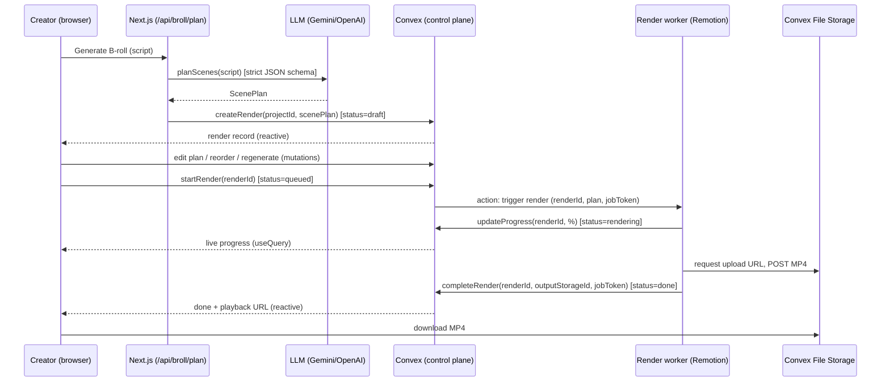

# Architecture — B-Roll Generation

Grounded in the **current** vidoscript stack: Next.js 16 (App Router) · Convex
(DB + File Storage) · Clerk (auth) · Gemini/OpenAI behind `getProvider()`.

- [1. Pipeline overview](#1-pipeline-overview)
- [2. Rendering: why not in Convex?](#2-rendering-why-not-in-convex)
- [3. Components & responsibilities](#3-components--responsibilities)
- [4. Data model (Convex)](#4-data-model-convex)
- [5. The ScenePlan contract](#5-the-sceneplan-contract)
- [6. Render infrastructure options](#6-render-infrastructure-options)
- [7. End-to-end sequence](#7-end-to-end-sequence)
- [8. Worker ↔ Convex contract](#8-worker--convex-contract)
- [9. File-by-file integration](#9-file-by-file-integration)
- [10. Security](#10-security)
- [11. Cost drivers](#11-cost-drivers)
- [12. Assets & licensing](#12-assets--licensing)

---

## 1. Pipeline overview

```
 saved script (existing)
        │
        ▼
 ┌──────────────┐   LLM (Gemini/OpenAI), strict JSON schema
 │  planScenes  │   reuses lib/gemini.ts / lib/openai.ts
 └──────────────┘
        │  ScenePlan (JSON)
        ▼
 ┌──────────────┐   user edits: template, props, order, duration, regenerate
 │ Plan editor  │   in-browser preview via @remotion/player (no server render)
 └──────────────┘
        │  scenePlan saved on the render record (Convex)
        ▼
 ┌──────────────┐   Convex action triggers external compute
 │ Render job   │   status is reactive via useQuery
 └──────────────┘
        │  Remotion render on a worker / Lambda → MP4
        ▼
 ┌──────────────┐   MP4 in Convex File Storage, linked to project
 │  Output      │   preview + download in history
 └──────────────┘
```

The only genuinely new stage vs today's `upload → transcribe → analyze →
generate` flow is **plan → render**. Everything else (LLM abstraction, storage,
auth, reactive history) already exists.

---

## 2. Rendering: why not in Convex?

**Question asked:** *"Can the rendering run in Convex?"*
**Answer: No — the render itself cannot. Convex runs everything *around* it.**

### Why the render can't live in Convex

Remotion produces frames by running a **real headless Chromium** browser, then
encodes them to MP4 with **ffmpeg**. That requires:

| Requirement | Convex function reality |
|-------------|-------------------------|
| Spawn a headless browser (Chromium) | ❌ No native binaries / no browser in the isolate |
| Run ffmpeg | ❌ No native binaries |
| Hundreds of MB–GBs of RAM | ❌ Tight memory limits |
| Seconds–minutes of CPU per video | ❌ Actions have short execution limits |
| Large temp disk for frames | ❌ No general filesystem |

Convex queries/mutations are deterministic and short; actions can call external
APIs and run longer but still run in a constrained serverless sandbox — **not** a
place to run a browser + video encoder.

### What Convex _does_ (its ideal role: the control plane)

- **State:** the `renders` table (plan, status, progress, output pointer, error).
- **Reactivity:** `useQuery(api.broll.getRender)` streams live status/progress to
  the UI with **zero polling** — this is Convex's superpower and exactly what a
  render queue UI wants.
- **Storage:** input assets + the output MP4 via **Convex File Storage**
  (`ctx.storage`) — the same mechanism already used for source videos in
  `convex/projects.ts` (`generateUploadUrl`, `getUrl`).
- **Orchestration:** a Convex `action` triggers the external renderer; the
  renderer calls back a Convex `mutation` to report progress/completion;
  `ctx.scheduler` enforces timeouts and retries.

> **Mental model:** Convex is the **brain and memory**; an external render worker
> (or Remotion Lambda) is the **muscle**. They talk over HTTP with a shared
> secret.

---

## 3. Components & responsibilities

| Component | Runs where | Responsibility |
|-----------|-----------|----------------|
| **Planner** (`planScenes`) | Next.js route `/api/broll/plan` (reuses `lib/gemini.ts`/`lib/openai.ts`) | Script → validated `ScenePlan` |
| **Plan editor** | React (dashboard) | Edit/reorder/regenerate scenes; live preview |
| **Preview** | `@remotion/player` in browser | Play the plan without a server render |
| **Render store** | Convex (`convex/broll.ts`) | `renders` CRUD, status, storage, orchestration |
| **Render trigger** | Convex `action` | Fire the external renderer with the plan + a job token |
| **Renderer** | External worker (container) or **Remotion Lambda** | Chromium+ffmpeg → MP4; upload to Convex storage; call back |
| **Asset resolver** | Next.js route or worker | Resolve stock clips (Pexels/Unsplash) for `footage` scenes |
| **Template library** | Remotion project (`/remotion`) | `renderFromPlan(scenePlan)` root composition + scene components |

---

## 4. Data model (Convex)

Add a `renders` table (mirrors the `projects` pattern already in
`convex/schema.ts`). Renders belong to a project and a user.

```ts
// convex/schema.ts  (addition)
renders: defineTable({
  userId: v.string(),                 // Clerk subject
  projectId: v.id("projects"),
  scenePlan: v.any(),                 // ScenePlan JSON (see SCENE_PLAN.md)
  status: v.union(
    v.literal("planning"),
    v.literal("draft"),              // plan ready, awaiting user
    v.literal("queued"),
    v.literal("rendering"),
    v.literal("done"),
    v.literal("failed"),
  ),
  progress: v.number(),               // 0..100
  aspect: v.string(),                 // "9:16" | "16:9" | "1:1"
  outputStorageId: v.optional(v.id("_storage")),
  error: v.union(v.string(), v.null()),
  jobToken: v.optional(v.string()),   // shared secret for the worker callback
  updatedAt: v.number(),
})
  .index("by_user", ["userId", "updatedAt"])
  .index("by_project", ["projectId", "updatedAt"]),
```

Notes:

- **`scenePlan: v.any()`** keeps the plan flexible while iterating; tighten to a
  full validator once the schema stabilizes (see SCENE_PLAN.md for the shape).
- Output MP4 stored via File Storage; `get` resolves a playback URL with
  `ctx.storage.getUrl(outputStorageId)` — identical to how project video URLs are
  resolved today.
- No new database system — this is the same Convex deployment.

---

## 5. The ScenePlan contract

The single interface between the script side and the render side. Full spec in
[SCENE_PLAN.md](./SCENE_PLAN.md). Summary:

```ts
// types/broll.ts
export type SceneKind = "motion" | "footage";

export interface Scene {
  id: string;
  kind: SceneKind;
  template: string;          // motion: "BigStat" | "Timeline" | ... ; footage: "Footage"
  props: Record<string, unknown>;
  caption?: string;
  query?: string;            // footage: stock search query
  assetRef?: string;         // resolved stock asset id/url
  durationSec: number;
  needsInput?: boolean;      // planner flagged missing data (e.g. a stat)
}

export interface ScenePlan {
  theme: string;             // brand/style token
  aspect: "9:16" | "16:9" | "1:1";
  scenes: Scene[];
}
```

The **planner** is forced (via provider JSON mode / tool schema) to emit only
valid `template` values with the required props for each — the same
structured-output technique already used by `analyzeTranscript`.

---

## 6. Render infrastructure options

Two viable homes for the **muscle**. Both keep Convex as the control plane.

### Option A — Remotion Lambda (AWS) — recommended for scale
- Remotion's serverless renderer; a single call renders and writes to S3, then a
  callback hits Convex.
- **Pros:** scales to many concurrent renders, pay-per-render, no server to babysit.
- **Cons:** AWS setup (IAM, S3, Lambda layer), cold starts, AWS bill.

### Option B — Self-hosted container worker — recommended for MVP simplicity
- A small Node service running the Remotion project in a Docker container on
  Railway / Render / Fly / Cloud Run.
- Triggered by a Convex `action` (HTTP POST) **or** it polls a Convex
  `listQueuedRenders` query.
- **Pros:** simplest mental model, predictable cost, easy local parity.
- **Cons:** you manage the box; limited concurrency without scaling it out.

**Recommendation:** start with **Option B (one container worker)** to ship the
MVP, design the worker↔Convex contract (below) so it's host-agnostic, then swap
in **Lambda** for scale without touching the app.

> Vercel/Next serverless functions **cannot** render Remotion (same limits as
> Convex — no browser, short timeouts). The render must be its own compute.

---

## 7. End-to-end sequence



ASCII fallback: `plan → createRender(draft) → edit → startRender(queued) →
worker renders (rendering, % callbacks) → upload MP4 → completeRender(done) → UI
updates reactively`.

---

## 8. Worker ↔ Convex contract

The external worker never touches the DB directly. It uses **public Convex
functions guarded by a per-job token** (`jobToken` on the render record):

| Call | Direction | Purpose |
|------|-----------|---------|
| `action broll.triggerRender` | Convex → Worker (HTTP POST) | Send `{ renderId, scenePlan, jobToken, callbackBaseUrl }` |
| `mutation broll.reportProgress` | Worker → Convex | `{ renderId, jobToken, progress }` → status `rendering` |
| `mutation broll.generateOutputUploadUrl` | Worker → Convex | Returns a File Storage upload URL (token-checked) |
| `mutation broll.completeRender` | Worker → Convex | `{ renderId, jobToken, outputStorageId }` → status `done` |
| `mutation broll.failRender` | Worker → Convex | `{ renderId, jobToken, error }` → status `failed` |

- **`jobToken`** is a random secret minted when the render is queued and cleared
  when it completes; the worker must present it on every callback. This lets the
  worker call public mutations without a Clerk session while preventing spoofing.
- `ctx.scheduler.runAfter(timeoutMs, ...)` marks a render `failed` if no callback
  arrives — safety net.

---

## 9. File-by-file integration

Everything slots into the existing structure.

| Piece | New/edited file | Reuses |
|-------|-----------------|--------|
| ScenePlan types | `types/broll.ts` *(new)* | — |
| Planner (script → plan) | `planScenes()` in `lib/gemini.ts` & `lib/openai.ts` *(edit)* | `getProvider()`, JSON-mode pattern from `analyzeTranscript` |
| Plan API | `app/api/broll/plan/route.ts` *(new)* | same shape as `app/api/generate/route.ts` |
| Asset resolver | `app/api/broll/assets/route.ts` *(new)* | image-proxy pattern in `app/api/instagram/image-proxy` |
| Convex render store | `convex/broll.ts` *(new)* | auth pattern from `convex/projects.ts` |
| Schema | `renders` table in `convex/schema.ts` *(edit)* | mirrors `projects` table + File Storage |
| Trigger render | `broll.triggerRender` action in `convex/broll.ts` *(new)* | — |
| Template library | `/remotion` Remotion project *(new)* | `product-video` skill can scaffold it; `ffmpeg-static` already in deps |
| Render entry | `renderFromPlan(scenePlan)` root composition *(new)* | — |
| Worker | `render-worker/` service (Docker) *(new)* | Remotion CLI/SSR |
| UI: generate + edit + status | on `app/(dashboard)/dashboard/project/[id]` and/or the main dashboard *(edit)* | existing project page, Radix UI, per-section regen UX |
| Preview | `@remotion/player` in the plan editor *(new dep)* | — |

**Planner placement — why Next.js, not a Convex action:** the LLM abstraction
(`lib/gemini.ts`/`lib/openai.ts`, `getProvider()`) already lives in Next.js with
its API keys in the Next env. Keeping `planScenes()` there avoids duplicating
provider logic and re-provisioning keys into Convex. The route writes the
resulting plan to Convex via `broll.createRender`. (If you later want the planner
reactive/queued, move it into a Convex action and set the keys with
`npx convex env set`.)

---

## 10. Security

- **Owner scoping:** every `renders` query/mutation checks
  `ctx.auth.getUserIdentity()` and matches `userId` — identical to `projects`.
- **Worker auth:** per-render `jobToken` (not a Clerk session); minted on queue,
  verified on every callback, cleared on completion.
- **Upload URLs** for the MP4 are short-lived (Convex File Storage) and only
  issued to a caller presenting the valid `jobToken`.
- **No secrets to the browser:** stock/LLM keys stay server-side (Next routes /
  worker). The client only ever sees Convex + Clerk public config.
- **Asset safety:** never fetch trademarked logos; only Pexels/Unsplash (licensed)
  or user uploads; store attribution where required.

---

## 11. Cost drivers

| Driver | Notes |
|--------|-------|
| LLM tokens (planner) | Cheap; one structured call per plan (+ per-scene regen) |
| Render compute | The main variable cost — Lambda seconds or worker CPU-minutes per video |
| Storage + egress | MP4s in Convex File Storage; watch quota (videos are large) |
| Stock/asset API | Pexels/Unsplash free tiers exist; mind rate limits |
| (Later) TTS | Per-character audio cost when voiceover is added |

Controls: cap script length / scene count in v1, limit concurrent renders, cache
resolved assets, and dedupe re-renders of unchanged plans.

---

## 12. Assets & licensing

- **Remotion:** free for individuals/companies up to 3 people (incl. commercial
  use); paid Company License ($100/mo min) only at 4+ people. Solo use today =
  free. Verify: https://www.remotion.pro/license
- **Stock:** Pexels/Unsplash under their licenses; store the asset id + required
  attribution on the scene.
- **Fonts:** Google Fonts (safe). Bundle, don't hotlink.
- **User uploads:** allowed; treated as user-owned content.
- **Never:** trademarked logos/emblems baked into templates (the classic
  productization landmine). Provide neutral placeholders + user-supplied brand
  assets instead.
